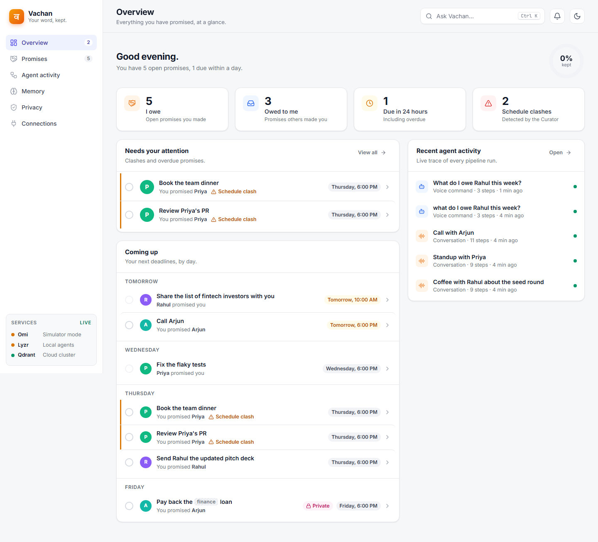
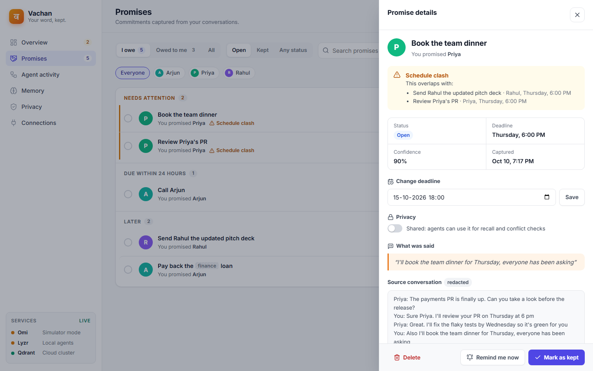
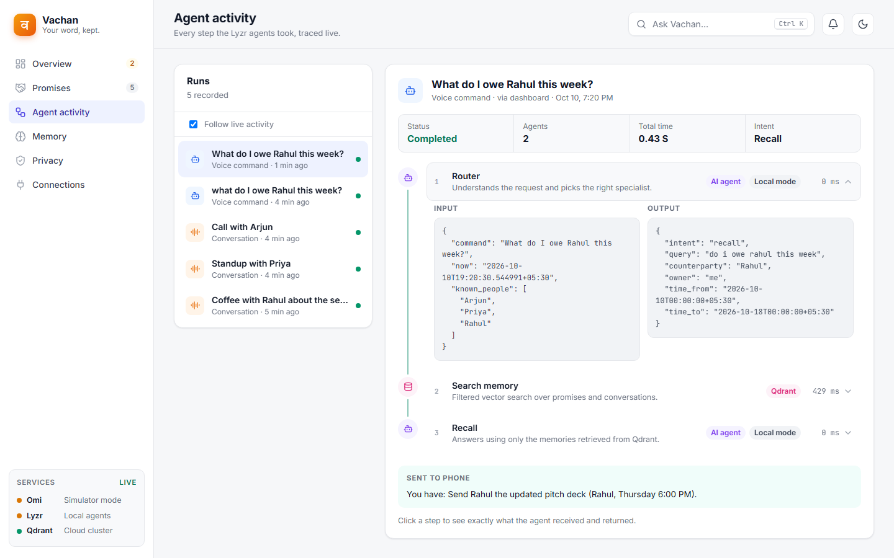
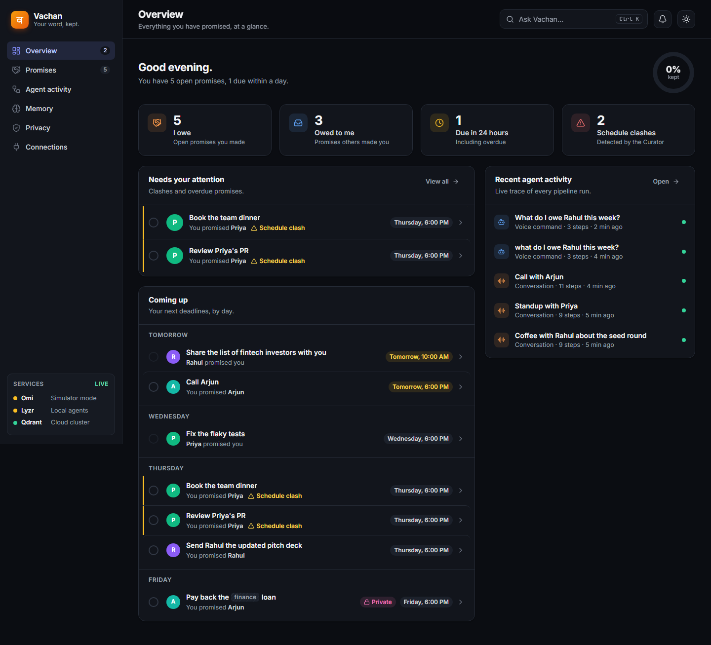
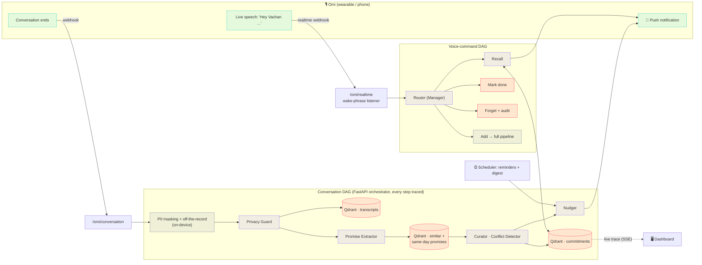

<div align="center">

# वचन · Vachan
### Your word, kept.

**An ambient multi-agent AI that catches every promise you make or receive in conversation,
remembers it, warns you about clashes, and nudges you before you break your word.**

Omi listens · Lyzr agents reason · Qdrant remembers

`Track 2: Collaborative Multi-Agent Workflows` · also covers Track 1 (Meeting Intelligence) and Track 3 (Privacy-First Knowledge)

</div>

---

## The problem
We make dozens of small promises every day: *"I'll send you the deck by Thursday"*, *"I'll review your PR tonight"*,
*"I'll call you Sunday"*. Most are spoken, so none of them reach a to-do app, and the forgotten ones quietly cost
trust. Note-takers record whole meetings, but nobody tracks **commitments**, and nobody tells you that Thursday 6 PM
is now promised to three different people.

## What Vachan does
| | |
|---|---|
| 🎙️ **Listens passively** | Omi captures your conversations. There is nothing to type and nothing to remember. |
| 🤝 **Extracts promises** | The promises you make (*"I owe Rahul the deck"*) and the ones made to you (*"Priya owes me the test fixes"*), with deadlines resolved from speech (*"Thursday evening"* → Thu 18:00 IST). |
| 🧠 **Remembers semantically** | Every promise and redacted conversation lives in **Qdrant**. Restating a promise updates it instead of duplicating it. |
| ⚠️ **Detects conflicts** | Vector search finds similar promises, a time-range filter finds same-day promises, and a Curator agent flags clashes and overload. You get a push on your phone. |
| ⏰ **Nudges you in time** | Reminders 24h and 2h before each deadline, plus a nightly digest, all as Omi notifications. |
| 🗣️ **Answers by voice** | *"Hey Vachan, what do I owe Rahul this week?"* / *"I sent the deck"* / *"Forget what I said about the loan"*. |
| 🔒 **Privacy-first** | On-device PII masking, *"off the record"*, a Privacy Guard agent, private memories that are **never sent to any LLM**, local embeddings, semantic "right to forget", and an audit log. |

## Screenshots
| Overview | Promise details |
|---|---|
|  |  |
| **Agent activity: every step traced live** | **Dark mode** |
|  |  |

## Architecture



**Six Lyzr agents** with strict JSON contracts ([backend/app/agents/](backend/app/agents/)):

| Agent | Input | Decides / produces |
|---|---|---|
| Privacy Guard | masked transcript | contextual redaction (health, finance), a sensitivity label per segment |
| Promise Extractor | redacted transcript + timestamp | `owner`, `counterparty`, `action`, `due_at`, `quote`, `confidence` |
| Curator / Conflict Detector | new promises + Qdrant neighbours + same-day promises | `create` / `update` / `skip`, plus `conflict` with the clashing ids |
| Nudger | events (captured / conflict / reminder / digest) | ≤160-char phone notifications |
| Router (Manager) | spoken command | intent (`recall` / `mark_done` / `forget` / `add`) + filters |
| Recall | question + retrieved memories | grounded 1–3 sentence answer |

**Agents share state through Qdrant.** The Curator sees what earlier conversations stored, the Recall agent reads what
the Curator wrote, and the scheduler wakes the Nudger from the same memory.

### Trust layer: every agent's output is verified in code
LLMs are great at language and unreliable at facts like *which date "Thursday" is*. Vachan never lets a
mistake reach your memory or your phone. Four on-device checks sit between the agents, and each appears as its
own step in the live trace with the corrections it made:

| Check | Catches (all observed live on Lyzr) |
|---|---|
| **Verify dates & people** | "Thursday evening" said on a Monday resolved to the wrong day; "you"/"me" returned as the other person |
| **Verify decisions** | Curator calling a brand-new promise a "duplicate" when Qdrant found nothing similar; a missed same-time clash |
| **Verify notifications** | A nudge naming the wrong weekday ("call Arjun Mon" when it's tomorrow): replaced with a correct one |
| **Reply contract** | An agent replying in the wrong JSON shape: a safe local fallback runs and the trace flags it |

Thresholds are calibrated on the embedding model: unrelated memories score 0.50–0.65, real matches 0.80+. So
*"I sent the deck"* never closes the wrong promise, and *"forget the loan"* deletes only the loan.

### Qdrant memory design
| Collection | Vector (384-d, cosine, local `bge-small-en-v1.5`) | Payload used for filtering |
|---|---|---|
| `transcripts` | redacted conversation chunk | `uid`, `conversation_id`, `started_ts`, `sensitivity`, `visibility` |
| `commitments` | "`action` — promised to/by `person`" | `uid`, `owner`, `counterparty_key`, `status`, `due_ts`, `visibility` |

- **Hybrid semantic + structured retrieval.** *"What do I owe Rahul this week?"* becomes a vector query with
  filters `counterparty_key = rahul`, `status ∈ {open, done}`, `due_ts ∈ [now, now+7d]`, `visibility = shared`.
- **Conflict detection** = vector neighbours (duplicates and reschedules) plus a `due_ts` range filter for the same day (clashes).
- **Forget** = a semantic query with a score threshold, then point deletion and an audit-log entry.

### Privacy model
1. **On-device first pass**: regex masking for phone, email, Aadhaar, PAN, cards and OTPs, and everything between
   *"off the record"* and *"back on the record"* is dropped **before any network call**.
2. **Privacy Guard agent** redacts what regexes can't (health conditions, money amounts) and labels sensitivity.
3. **Private memories**: anything sensitive is stored with `visibility=private`. Private items are excluded from every
   LLM prompt. Their notifications are written on-device, and only you see them on the dashboard.
4. **Local embeddings** (fastembed): raw text never goes to an embedding API. Qdrant can run fully embedded on disk.
5. **User control**: toggle any memory private/shared, delete it, or say *"forget …"*. Every change is in the audit log.

## Observability
Every run (conversation, voice command, reminder, digest) and every step (agent, Qdrant op, Omi push) emits a
trace event. The dashboard streams them over SSE as a **live DAG**: click any node to see the exact JSON the agent
received and returned, plus latency and whether it ran on Lyzr, on mock, or on-device. Traces are also written to
`backend/data/traces.jsonl`.

## Quick start (about 5 minutes, works with zero API keys)

> Needs **Python 3.10+** and **Node 18+**. Without keys every service falls back to a local mode, so you can
> see the full loop first and plug keys in later.

```bash
# 1. backend
cd backend
python -m venv .venv
.venv\Scripts\activate            # macOS/Linux: source .venv/bin/activate
pip install -r requirements.txt
copy .env.example .env            # macOS/Linux: cp .env.example .env  (then fill in keys)

# 2. dashboard (built once, then served by the backend)
cd ../frontend && npm install && npm run build && cd ../backend

# 3. run
uvicorn app.main:app --port 8000
# open http://localhost:8000

# 4. click "Try it with demo conversations" on the welcome screen
#    (or from a terminal: replay Omi webhooks including a spoken command)
backend\.venv\Scripts\python scripts/simulate_omi.py fixtures/*.json --say "Hey Vachan, what do I owe Rahul this week?"
```

Press **Ctrl K** anywhere in the dashboard to ask Vachan something. It works the same as saying "Hey Vachan…" to Omi,
and has a microphone button in Chrome or Edge.

For dashboard hot-reload, run `npm run dev` in `frontend/` and open http://localhost:5173.

### Going live
| Service | Guide | What changes |
|---|---|---|
| Lyzr | [docs/LYZR_SETUP.md](docs/LYZR_SETUP.md) | Agents run on Lyzr Studio (pill shows `6/6 agents live`) |
| Qdrant Cloud | set `QDRANT_URL` + `QDRANT_API_KEY` | Memory moves to your cluster, with payload indexes created automatically |
| Omi | [docs/OMI_SETUP.md](docs/OMI_SETUP.md) | Real conversations come in, and nudges land on your phone |

If a live Lyzr call fails mid-demo, that step falls back to a deterministic local agent and the trace marks it
`fallback`. The loop never breaks.

## Tests
```bash
cd backend && .venv\Scripts\python -m pytest -q
```
29 tests cover PII masking, off-the-record handling, deadline resolution, JSON parsing of LLM replies, the full
conversation DAG, cross-conversation conflict detection, deduplication, private memories never reaching agents,
voice commands (recall / done / forget), and the wake-phrase listener.

## Repository layout
```
backend/app/
  main.py          FastAPI: Omi webhooks, dashboard API, SSE trace stream
  pipeline.py      conversation DAG (privacy → extract → curate → nudge)
  commands.py      voice-command DAG (router → recall / done / forget / add)
  memory.py        Qdrant collections, filtered search, forget + audit
  lyzr_client.py   Lyzr Studio client with JSON contracts and mock fallback
  mock_agents.py   deterministic local agents (offline mode / fallback)
  omi.py           Omi payload parsing, wake-phrase listener, push notifications
  privacy.py       on-device PII masking and off-the-record
  scheduler.py     deadline reminders and nightly digest
  trace.py         observable workflow events
  agents/*.md      system prompts for the six Lyzr agents
frontend/          React dashboard: overview, promises, live agent activity, memory, privacy, connections
scripts/           simulate_omi.py, which replays Omi webhooks without a device
fixtures/          demo conversations (promise, clash, sensitive + off-the-record)
docs/              setup guides and demo script
```

## Roadmap
- Calendar write-back (block time for promises) and an email draft agent for "send X" promises.
- Per-person trust timeline ("you kept 9/10 promises to Priya this month").
- Shared team memory: promises made in a meeting become visible to everyone in it.
